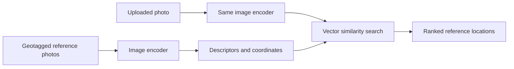

# Heimdall Spy

An experimental photo-geolocation project for Sweden, starting with Linköping.
The goal is to locate ordinary outdoor photos from their visual content, inspired
by GeoSpy. The application package is currently named **SweSpy**.

The working approach is visual place recognition: compare an uploaded photo with
a collection of geotagged reference photos and return likely locations. We have a
CLIP API, measured MegaLoc experiments, and a growing Mapillary reference gallery.
We have not established accuracy on arbitrary photos across Sweden.

## How it works

Reference photos are converted into numerical image descriptors (embeddings),
which are stored alongside their known GPS coordinates. A query photo goes through
the same model; vector search retrieves visually similar references.



There are two separate implementations today:

| Path | Encoder and search | Output / status |
| --- | --- | --- |
| Existing API | Pretrained CLIP ViT-L/14; 768-dimensional descriptors; Qdrant cosine search | Top five references and a similarity-weighted average GPS pin |
| MegaLoc experiments | Pinned pretrained MegaLoc; 8,448-dimensional descriptors; FAISS for paper/dense evaluation, separate Qdrant collection for the earlier comparison | Ranked reference matches, reproducible metrics and maps; not integrated into the API |

Expanding the reference gallery is **not model training**: a pretrained encoder can
index new places without changing its weights. Reference coverage and visible scene
overlap still limit what it can precisely match. The API's confidence field is a
similarity-derived score, not a calibrated probability. Averaging distant matches
can give a misleading pin; geographically consistent candidates are planned.

## Technologies

| Technology | Role |
| --- | --- |
| Python 3.12, uv and `uv.lock` | Application code and reproducible dependencies |
| PyTorch, torchvision, Hugging Face Transformers / safetensors | Pretrained image models, preprocessing and weight loading |
| CLIP | General-purpose image encoder used by the current API |
| MegaLoc | Place/landmark retrieval encoder used in the newer experiments |
| FastAPI, Uvicorn, Pydantic | Image-upload API, server, request/response schemas and configuration |
| Qdrant | Persistent reference-vector database for the application |
| FAISS, NumPy, scikit-learn | Exact benchmark search, descriptor arrays and geographic evaluation |
| Mapillary Graph API, HTTPX, asyncio, Tenacity | Geotagged imagery acquisition, bounded concurrency and retries |
| Pillow | Image decoding, validation and duplicate-screening inputs |
| S2 / UTM, pandas / PyArrow | Geographic cells, local metric coordinates and ingestion metadata |
| Leaflet, OpenStreetMap, Matplotlib | Interactive result/coverage maps and static experiment plots |
| Docker Compose | Local API and Qdrant services |
| pytest, Ruff, mypy | Tests, lint and type checks |

MegaLoc experiments run natively on the Mac's Apple GPU through PyTorch MPS;
the container API defaults to CPU and its encoder also supports CUDA. A separate
optional benchmark environment avoids changing the application's dependency lock.

PIGEON/PIGEOTTO are relevant research directions for broader geographic prediction,
but they are **not implemented in the current source**. There is no deployed
vision-language explanation model or Swedish backbone fine-tuning. A small trained
geographic head is available through explicit CLI inference, with measured limits.

## Start the API

Install Docker with Compose, then run from the repository root:

```bash
cd swespy
docker compose up --build
```

API documentation: <http://localhost:8000/docs>. Health: <http://localhost:8000/health>.
Initial startup may download CLIP weights. Starting services does not download
reference photos, populate a new Qdrant collection or train a model.

With a populated compatible reference collection, upload a JPEG or PNG:

```bash
curl -X POST http://localhost:8000/predict -F 'file=@/path/to/photo.jpg'
```

For local Python development and configuration, see [the application README](swespy/README.md).
Keep credentials in ignored `swespy/.env`; use `.env.example` as the template.

## Data and evaluation

- [Agent handoff](docs/AGENT_HANDOFF.md): current state, recent changes, artifact
  paths, environment, safeguards and remaining work. Start here when changing agents.
- [RAG and modern ML explained](docs/ML_TECHNOLOGY.md): what these techniques mean
  and which ones this project actually uses.
- [Evaluation setup and commands](swespy/eval/README.md): benchmark environment,
  acquisition, cached inference, metrics and reports.
- [Paper reproduction and dense Linköping results](docs/PAPER_REPRODUCTION.md):
  Baidu Recall@1 **87.7%**, Recall@10 **98.0%**, matching the published rounded
  targets; the small central-Linköping test achieved **11/18** first-choice matches
  within 25m. These are distinct datasets, not comparable accuracy guarantees.
- City-wide acquisition: from `swespy/`, run
  `.venv-benchmark/bin/python -u -m eval.expand_linkoping` after preparing the
  benchmark environment and configuring the private Mapillary token. The separate
  output is `data/linkoping_dense/city_v1/`, including a manifest, images,
  `coverage.html` and `coverage.geojson`.
- [Completed city-wide gallery expansion](docs/GALLERY_EXPANSION.md): 3,388
  reference photos across 305 capture sequences, with coverage-map links.
- [Expanded-gallery evaluation](docs/CITY_EVALUATION.md): the gallery is now
  encoded and searchable through a separate MegaLoc CLI; all48 frozen queries
  were measured. The central25m score is unchanged and wider coverage remains weak.
- [Recent ordinary-photo test](docs/PUBLIC_PHOTO_TEST.md): free Commons-only
  collector and completed evaluation of66 reviewed outdoor photos captured since
  November2023. Current results are poor:1/66 first-choice matches within100m.
- [Failure audit and first training experiment](docs/FIRST_TRAINING_EXPERIMENT.md):
  a trained143-cell geographic head and checkpoint inference, compared with
  retrieval and constant-location priors. It did not beat the majority-area prior.
- [Recent paired-view data pilot](docs/PAIRED_VIEW_PILOT.md):13 reviewed pairs and
  25 fresh Commons holdout photos. Only8 training pairs remain after separation;
  this validates the workflow, not a claim of improved geolocation.


Downloads, virtual environments, model weights, descriptor caches, generated maps
and local Qdrant storage are ignored by Git. A clone alone does not restore them;
back up required artifacts separately. Gallery manifests retain source attribution
and licensing links. Existing evaluation capture sequences stay out of the expanded
gallery; duplicate screening provides additional protection.

## Next milestone

Improve photographic reference/training coverage for pedestrian views and
landmarks, then add a fresh spatially balanced, creator-separated holdout. The
first geographic-head experiment is complete and did not beat a constant-area
prior. Existing API inference remains CLIP; MegaLoc and the trained head can be
searched explicitly through the CLI. PIGEOTTO-style training and cross-view
retrieval fine-tuning remain research directions.

## Research

- [MegaLoc: One Retrieval to Place Them All](https://arxiv.org/abs/2502.17237)
- [PIGEON: Predicting Image Geolocations](https://arxiv.org/abs/2307.05845)

