# Local demo: try the system on your own photos

Localhost only. Nothing is published, deployed or bound to other interfaces.

## Start and stop (Mac, native, fastest)

```bash
cd ~/Documents/GitHub/heimdall-spy/swespy
scripts/run_local.sh            # then open http://127.0.0.1:3000
```

Stop both servers with **Ctrl-C**. The script builds the web app, starts the API in the
background, waits until its `/ready` answers (~70 s), then starts the web server:

| Process | Address | What it does |
| --- | --- | --- |
| API (FastAPI/uvicorn) | 127.0.0.1:8000 | All inference. Loads model and gallery once (~60 s; prints nothing until `Application startup complete`) |
| Web (Next.js 16, TypeScript, Tailwind 4, MapLibre GL) | 127.0.0.1:3000 | Long-running Node server (`output: "standalone"`, `node server.js`). Serves the page and forwards `/api/*` unchanged to the API. No API routes, server actions or serverless functions |

The web server starts once the API's `/ready` answers. MegaLoc and ALIKED run on the
Apple GPU (LightGlue on CPU), with re-ranking on (K = 5, 1,024 keypoints). Measured:
**3–6 s per photo**.

Web development: `cd web && npm run dev` (hot reload on 127.0.0.1:3000, API still needed).
Checks: `npm run typecheck && npm run lint && npm run check:tokens && npm run check:contrast`.
End-to-end (with the demo running): `node scripts/e2e.mjs <expected.json>`.

## What the page does ("Heimdall" workspace, v2)

The map is the workspace: it runs full-bleed under two floating panels, a 48 px rail on
the left and a 380 px inspector on the right (each 12 px from the window edges, 1 px rule,
6 px radius). On phones the inspector is a bottom sheet. All inference stays in FastAPI;
the page calls only the public endpoints (`POST /analyze`, `POST /predict/stream`,
`GET /references/{id}/image`).

### Flow: photo, region, then Locate

1. **Choose or drop a photo** (button, or anywhere on the map). The page calls
   `/analyze`: if people cover more than 30%, the suggested region is pre-drawn with a note.
   For HEIC, which Chrome cannot show, `/analyze` also returns an upright JPEG preview
   (at most 1600 px, no metadata); the original file is what is searched, and region
   coordinates refer to the same upright pixels. **Nothing is searched until Locate.**
2. **Optionally drag a box** (arrows move it, Shift with arrows resizes); "Use whole photo"
   clears it.
3. **Locate.** After a result, the part of the photo whose match won is outlined as
   "Searched area"; "Change region" lets you adjust and locate again.

### The inspector after a result

- **Result block:** state ("Confident" / "Low confidence"), place name, coordinates with a
  copy button, then label–value rows: Matched details, Closest rival (details, distance),
  Searched area (Whole photo / Your region / Automatic: …), Reference (source, year,
  distance), Time. Low confidence adds one line: "Too few matching details to be sure.
  Compare before relying on it." and a "Try a different region" button.
- **Candidates:** rank, place, distance from #1, matched details with a bar relative to
  #1, a compare button and a verdict control (Matches / Doesn't match / Unsure). Verdicts
  are kept with the session's recent searches only, never sent to the server. The
  selected row has a 2 px cobalt outline.
- **Compare** (from the result block, a row or the map callout) opens a large overlay over
  the map area: your searched area and the reference side by side, or a swipe view; the
  credit line; the verdict control. Escape or the close button returns to the map.

### The map

- Light basemap with tonal depth (land, residential, buildings and 3D extrusions step
  darker; white roads on darker casings). District labels 14 px, street labels 11 px; all
  labels pass WCAG AA against their halos (`scripts/check-contrast.mjs`).
- **Only the selected result has contour rings:** three solid rings, cobalt when
  confident, amber when not. Other candidates are 20 px numbered squares. Markers never
  overlap each other, the pin or the callout: a crowded square moves to the nearest free
  slot and a thin leader points back to its true position (`src/lib/markers.ts`).
- The callout shows only the place name and "Compare". Controls (zoom, reset north,
  2D/3D) sit bottom-right, left of the inspector. The camera keeps results in the visible
  area between the panels.

### The locating sequence (the map is the loading state)

Driven by the streamed pipeline events, not by timers; each phase holds a minimum time so
fast answers still read clearly.

| Event from `/predict/stream` | Map | Inspector |
| --- | --- | --- |
| Locate pressed (min 900 ms) | Dims (paper at 55%); frames the Linköping polygon, tilts to 35°, rotates about 4°/s. Centre label "Searching Linköping" with Cancel | Stage list: "Search references" running |
| `candidates` (top 50) | 50 dots fade in, strongest first. Label: "Comparing the 5 closest matches" | Search done (seconds) |
| `stage: verification` | Rotation stops; flight to the top 5; the other 45 dots fade out; dashed rings | |
| `verified` × 5 | Each candidate's rings ease to a radius set by its matched details | |
| `result` | Dim lifts. Confident: zoom 16, pitch 45°, 3D buildings. Low confidence: all 5 in view, flat, amber pin. The selected result's rings draw in; callout | Result block, candidates |

Cancel, errors and reduced motion behave as before: Cancel stops the server work and
keeps the photo and region; errors are one line with "Try again"; reduced motion jumps
instead of flying.

### Streaming API

`POST /predict/stream` (same form fields as `/predict`) returns NDJSON
(`application/x-ndjson`). Events, in order:
- `{"type":"stage","stage":"retrieval"}`
- `{"type":"candidates","items":[{id,lat,lng,similarity}×50]}`: locations only, never images or sources
- `{"type":"stage","stage":"verification","count":5}`
- `{"type":"verified","id","inliers","score"}`, one per candidate as it completes
- `{"type":"result", …exactly /predict's response…}`
- `{"type":"error","message"}` on failure

How it's built and verified:
- **One code path:** both routes run `GeoLocator.locate_events`; `/predict` returns its
  final result, so the two cannot differ. On the running stack the streamed result was
  byte-identical to `/predict` for 3 dev photos, and both match the frozen evaluation.
- **Cancellation:** a client disconnect sets a flag the pipeline checks between steps
  (tested: work stops within one step).
- **Proxy:** the Next.js proxy passes the stream through unbuffered. Measured: candidates
  at 1.3 s, each verification ~0.35 s apart, result at 4.2 s.

### Region, place names, About

- **Region:** the form field `region` = JSON `{"x","y","width","height"}`, normalised to
  the upright photo; retrieval and re-ranking both see only that part.
- **Place names:** offline reverse geocoding from OpenStreetMap street and district names
  (`public/data/places.json`).
- **About:** the dev results with 95% intervals, read from
  `eval/results/dev_historic_rerank.json` at build time; the coverage map; failure modes
  with a real manual-crop example; data and licences.

### Checks (v2, 2026-11-11)

Run against a production build of the v2 UI (`web/scripts/e2e-v2.mjs`, Chrome via
playwright-core). The API is mocked, so every state is deterministic. The HEIC check uses
the real `/analyze` decode-and-preview code (API in test mode, no model) with the
synthetic fixture `tests/fixtures/pattern.heic`.

| Check | Result |
| --- | --- |
| Layout: full-bleed map; rail 48 px and inspector 380 px at 12 px insets; controls bottom-right left of the inspector; no "Linköping" label | pass |
| Result block: the five label–value rows, rival with a comma, searched area named, no prose; type 18 / 13 / 12 px | pass |
| Candidates: 5 rows, verdict toggles, selected row has a 2 px outline (no fill) | pass |
| Compare overlay over the map area (not the inspector), labels, verdict, swipe mode, Escape closes | pass |
| Low confidence: one amber line, flat overview, amber pin | pass |
| **Markers: 5 candidates within 50 m, no overlapping markers** (two zoom levels), and spread candidates | pass |
| Mobile 390×844: no horizontal scroll; Compare is the first result button | pass |
| HEIC in Chromium: preview shown, region drawn on it | pass |
| Total | **35 / 35** |
| Contrast (all UI text, map labels against their halos, map marks), tokens (colours, radii, font sizes), type check, lint | pass |

Not re-run for v2: the real-model checks of the previous UI (`scripts/e2e.mjs`,
`scripts/e2e-regions.mjs`) still use v1 selectors and need updating.

### Screenshots (v2)

| | |
| --- | --- |
| Empty | 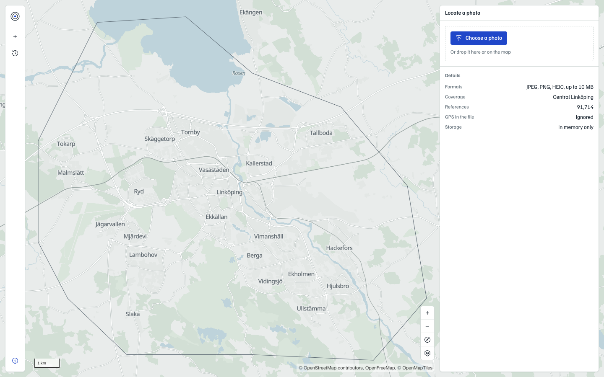 |
| Locating | 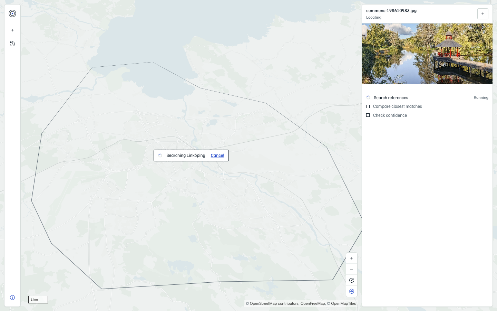 |
| Confident | 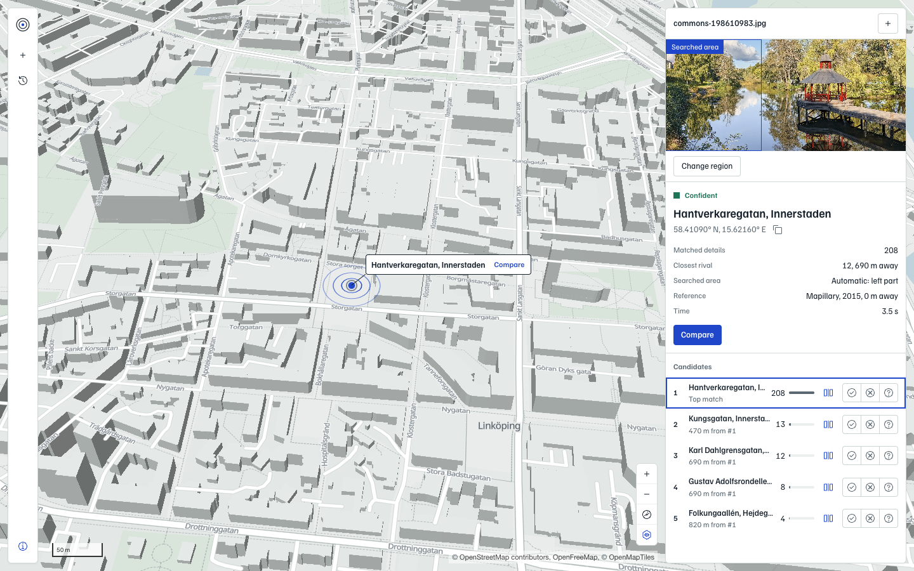 |
| Compare, side by side | 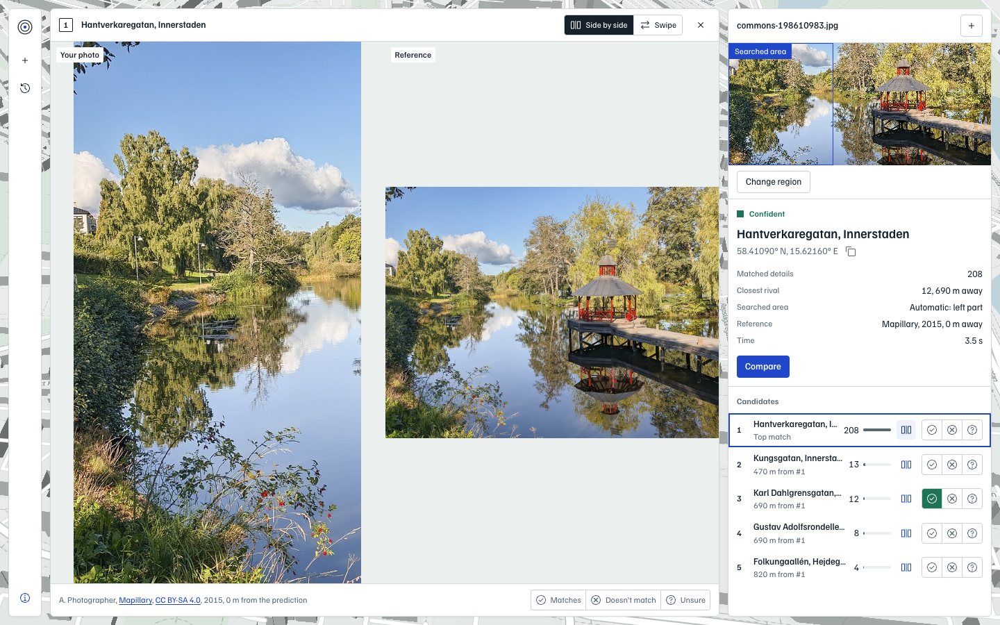 |
| Compare, swipe | 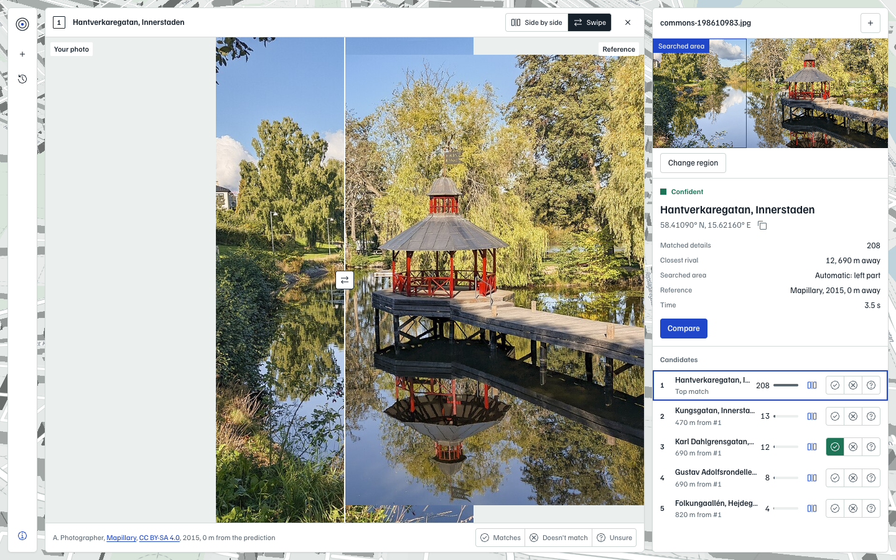 |
| Low confidence | 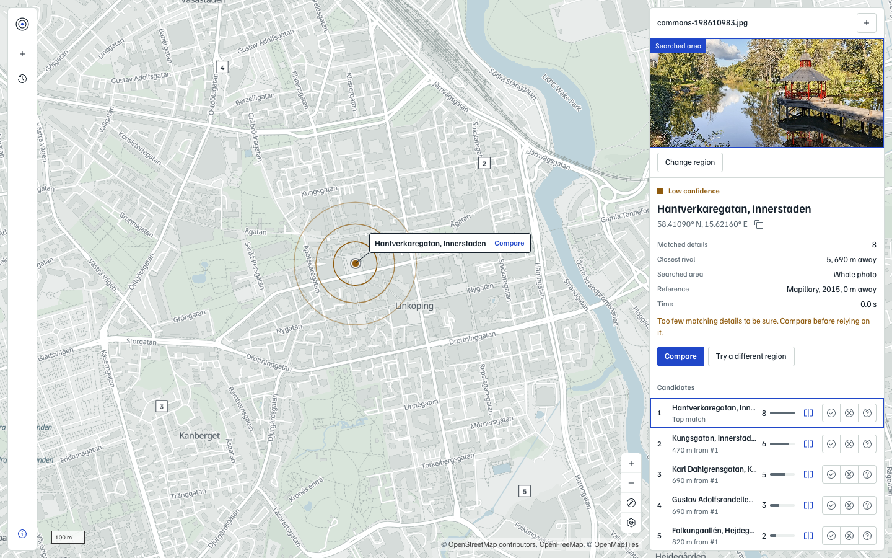 |
| 5 candidates within 50 m (markers offset, leaders to true positions) | 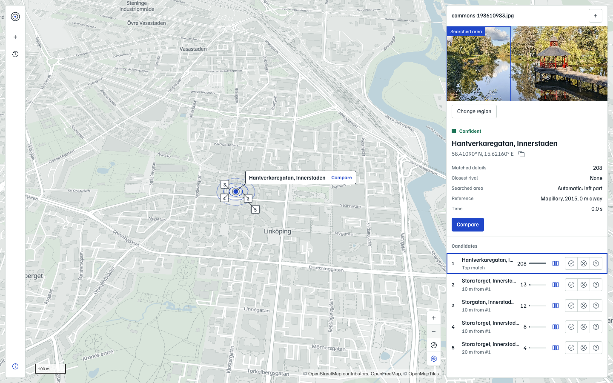 |
| HEIC in Chromium, region drawn on the preview | 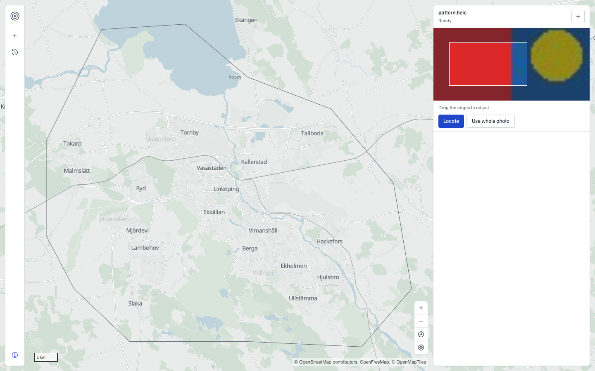 |
| Mobile 390×844: empty, confident, compare | 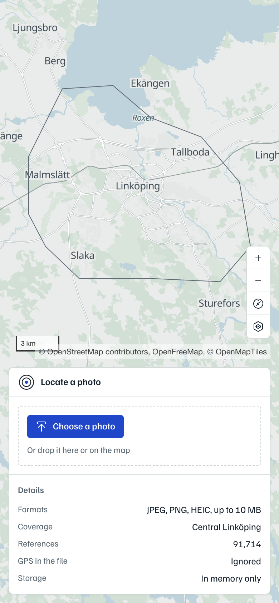 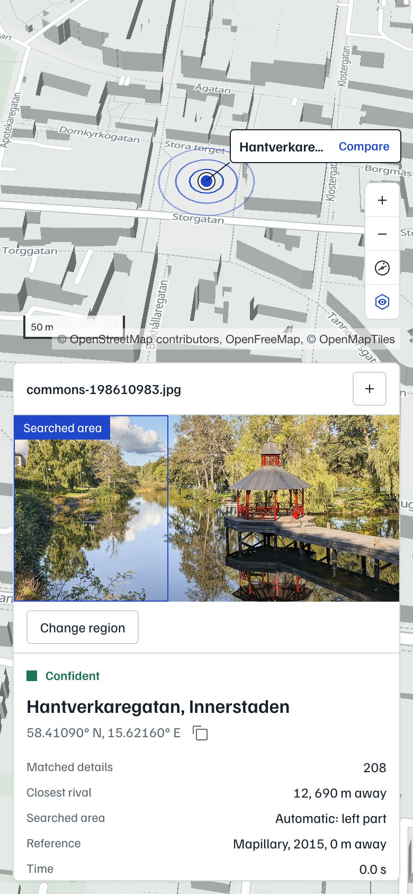 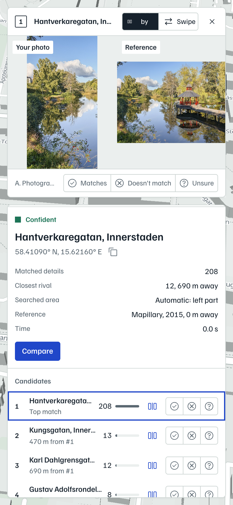 |

## Privacy

- `/predict` processes the upload in memory and writes nothing. A test checks that no
  file appears; logs contain no image hash or coordinates.
- **No location metadata is used.** Every upload goes through
  `swespy/model/imageio.py:decode_upload`, which applies EXIF orientation and then
  copies only the RGB pixels, so EXIF/GPS/XMP never reach the model. A test checks that
  a GPS-tagged JPEG gives exactly the same pixels as an untagged one.

## iPhone photos

- HEIC is decoded server-side by `pillow-heif` (optional `heic` extra, installed in the
  local `.venv`). EXIF orientation is applied, so portrait photos are upright. Chrome
  cannot preview HEIC, so "Your photo" shows a placeholder there; Safari previews it.
- A HEIC *converted* from a JPEG is a re-compressed image: on borderline photos the top
  candidates are within 0.01 cosine, so the answer can change. Checked on one dev photo:
  the HEIC and a lossless PNG of its decoded pixels gave identical results, and a JPEG
  re-saved at quality 80 already moved the inlier counts. The decoder is faithful; the
  model is sensitive to compression on hard photos.
- Licence: `pillow-heif`'s binary wheels are **GPL-2.0** (they bundle the x265
  encoder; only the LGPL decoders are used). It is therefore optional and **not in the
  default Docker image**. Build with `--build-arg EXTRAS=heic` to include it. Decide
  before distributing that image (GPL source-offer obligations).

## Docker (CPU, for parity with a server)

The compose file runs the API only; the Next.js app is not containerised yet.

```bash
cd ~/Documents/GitHub/heimdall-spy/swespy
docker compose up --build       # http://127.0.0.1:8000/demo ; stop: Ctrl-C, then `docker compose down`
```

| | Measured 2026-11-09 (Docker Desktop, Apple M1, linux/arm64) |
| --- | --- |
| Image | multi-stage; **2.06 GB** unpacked (458 MB compressed); no weights or gallery inside |
| Mounted read-only | `gallery-index-historic.json`, `gallery_v2/images` (4.8 GB), `megaloc` (3.2 GB), `huggingface` (0.9 GB), `torch` (48 MB); `field_photos` read-write |
| Startup to `/ready` | **75 s** |
| Peak memory | **5.4 GiB** (Docker VM has 7.65 GB) |
| `/predict` | 20–22 s (CPU only: Docker on a Mac cannot use the Apple GPU) |
| Correctness | 2 dev photos: top-1, confidence state and inliers identical to the evaluation |

Fixes found while testing the container:

- **OOM at startup:** the gallery loader made several full copies of 3.1 GB of
  descriptors. It now streams them into FAISS in 4,096-row chunks.
- **faiss-cpu 1.9 on ARM64 Linux crashed** probing SVE via `numpy.distutils` (absent on
  Python 3.12). `FAISS_OPT_LEVEL=generic` skips the probe.
- **Read-only mounts:** the descriptor cache folder is now created only when written to.

## Endpoints

| Endpoint | Purpose |
| --- | --- |
| `GET /health` | Liveness |
| `GET /ready` | 200 + versions once model and gallery are loaded, else 503 |
| `POST /predict` | Upload → top 5 candidates, scores, inliers, confidence state, versions |
| `GET /references/{image_id}/image` | Stored 640 px reference image (for attribution display) |
| `POST /field-photos` | Opt-in save of a field photo + true location (future evaluation only) |
