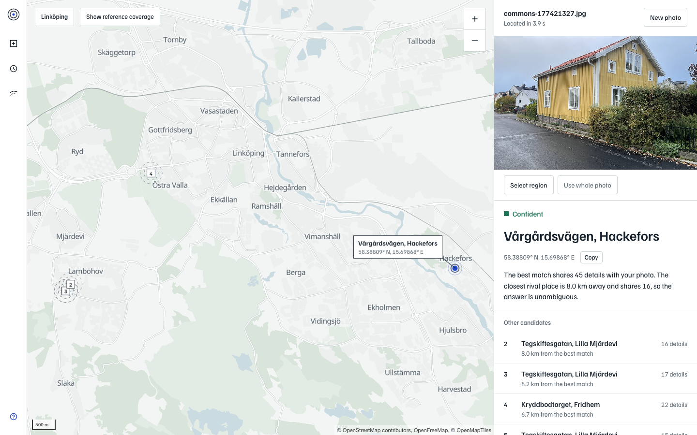
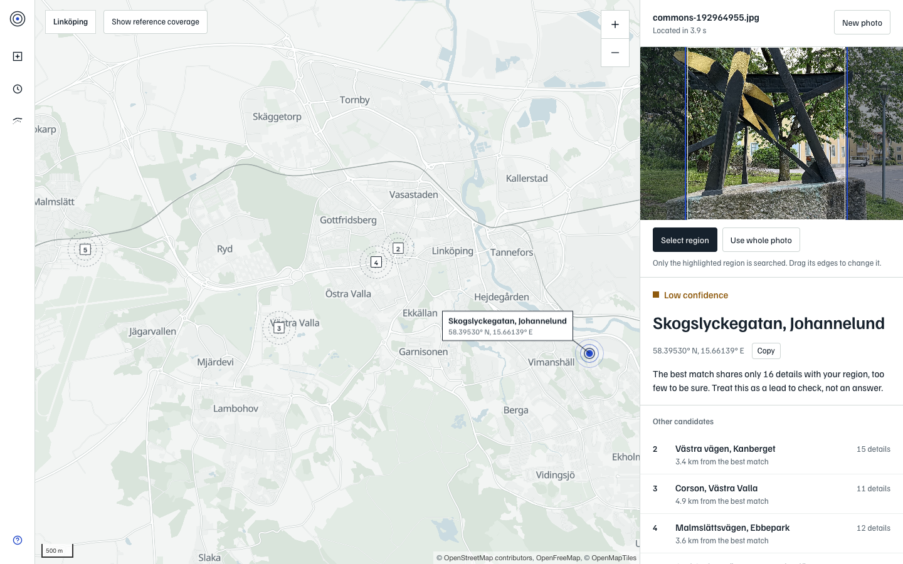
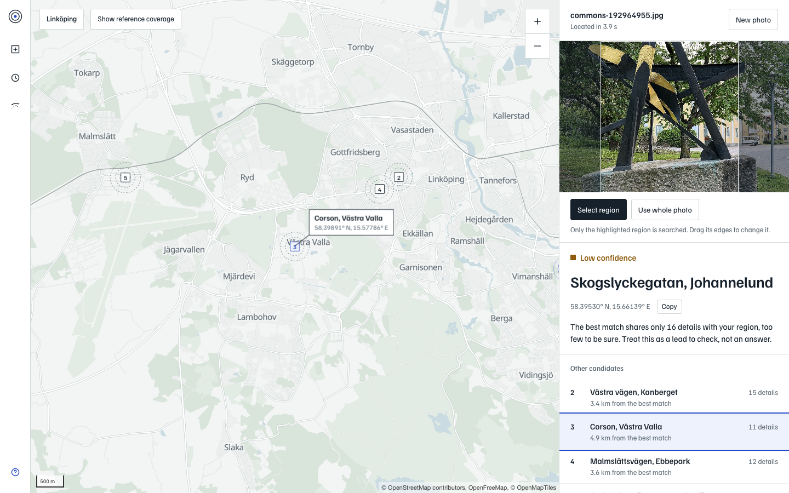
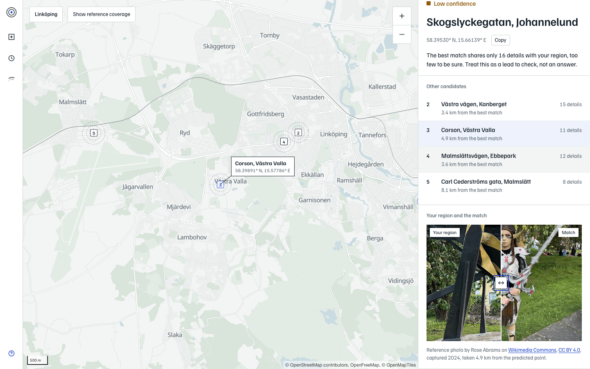
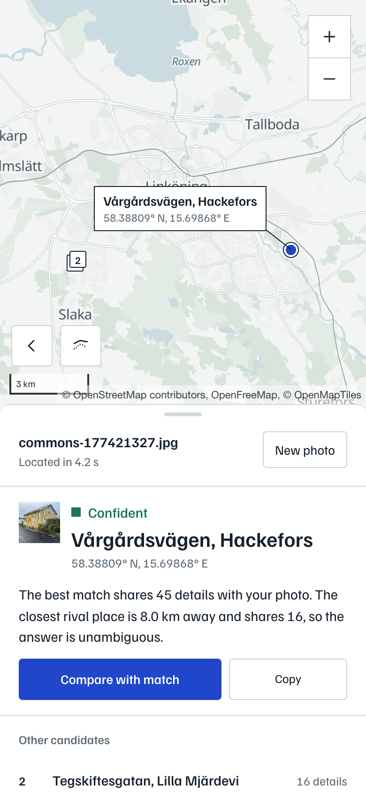
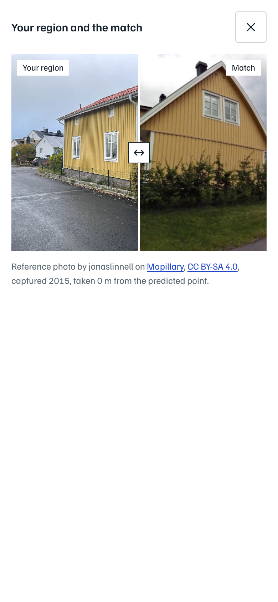

# Local demo: try the system on your own photos

Localhost only. Nothing is published, deployed or bound to other interfaces.

## Start and stop (Mac, native, fastest)

```bash
cd ~/Documents/GitHub/heimdall-spy/swespy
scripts/run_local.sh            # then open http://127.0.0.1:3000
```

Stop both servers with **Ctrl-C**. The script builds the web app, starts the API in the
background, waits until its `/ready` answers (~70 s), then starts the web server:

| Process | Address | What it does |
| --- | --- | --- |
| API (FastAPI/uvicorn) | 127.0.0.1:8000 | All inference. Loads model and gallery once (~60 s; prints nothing until `Application startup complete`) |
| Web (Next.js 16, TypeScript, Tailwind 4, MapLibre GL) | 127.0.0.1:3000 | Long-running Node server (`output: "standalone"`, `node server.js`). Serves the page and forwards `/api/*` unchanged to the API. No API routes, server actions or serverless functions |

The web server starts once the API's `/ready` answers. MegaLoc and ALIKED run on the
Apple GPU (LightGlue on CPU), with re-ranking on (K = 5, 1,024 keypoints). Measured:
**3–6 s per photo**.

Web development: `cd web && npm run dev` (hot reload on 127.0.0.1:3000, API still needed).
Checks: `npm run typecheck && npm run lint && npm run check:tokens && npm run check:contrast`.
End-to-end (with the demo running): `node scripts/e2e.mjs <expected.json>`.

## What the page does ("Heimdall" workspace)

A light, map-first workspace. All inference stays in FastAPI: the page calls only the
public endpoints (`POST /predict`, `GET /references/{id}/image`, `GET /ready`).

- **Layout (desktop, >= 1100 px):** rail (new search, recent searches for this session,
  reference coverage, How it works), full-height MapLibre map, 420 px inspector.
  **Mobile (375–430 px):** map on top with floating 44 px buttons, result in a bottom
  sheet, compare full screen.
- **Map:** OpenFreeMap vector tiles restyled from the design tokens (muted roads, pale
  water, 2D buildings, district names), attribution "© OpenStreetMap contributors,
  OpenFreeMap, © OpenMapTiles". Reference coverage: cobalt dots along streets that have a
  reference within 25 m (`public/data/coverage.geojson`).
- **Contour rings (uncertainty):** each candidate gets 3 rings whose spacing comes from one
  documented function of its matching details (`src/lib/rings.ts`). The prediction is a
  cobalt pin with solid rings; other candidates are numbered squares with wider dashed
  rings. A callout with the place name and coordinates is joined to the selected point.
- **Inspector:** file name and time, the photo with **Select region** (only the
  highlighted part is searched; drag or use the arrow keys, Shift resizes), the state
  line (Confident / Low confidence), place name, coordinates with Copy, one plain
  reason built from the API data, **Other candidates** (synced with the map), and **Your
  region and the match** (swipe compare with a keyboard slider and the credit line).
- **Region:** `POST /predict` takes an optional form field `region` = JSON
  `{"x","y","width","height"}` normalised to the upright photo; retrieval and re-ranking
  both see only that part (`swespy/model/imageio.py:crop_region`, tested).
- **Place names:** offline reverse geocoding from OpenStreetMap street and district names
  (`public/data/places.json`, generated by `scripts/build_web_data.py`).
- **About page (`/about`):** what it does, how, the dev results with 95% intervals (read
  from `eval/results/dev_historic_rerank.json` at build time by `web/scripts/prepare.mjs`),
  failure modes with a real manual-crop example (all attempts recorded by
  `scripts/crop_example.py`), data and licences, and what it does not do.
- **Not in this design:** the earlier "save this photo for later evaluation" option. The
  `POST /field-photos` endpoint is unchanged.

### Checks (2026-11-10)

| Check | Result |
| --- | --- |
| Playwright, 1440×900 and 390×844 (`web/scripts/e2e.mjs`) | 24 / 24 |
| API-equals: UI top 5, details and state = eval, 3 dev photos | pass (2 Confident, 1 Low confidence) |
| Keyboard: Tab reaches every action; Enter selects candidates (list and map); arrows move the region and the compare divider | pass |
| Focus ring | 2 px solid cobalt, 2 px offset (computed style checked) |
| Contrast (`npm run check:contrast`), 23 pairs | all pass WCAG AA (lowest 4.55:1, street names) |
| Off-token values (`npm run check:tokens`) | none |
| Type check, lint | clean |

### Screenshots

| Desktop 1440×900 | |
| --- | --- |
| Empty state, coverage on |  |
| Result (Confident) |  |
| Region selected |  |
| Candidate 3 selected (list and map) |  |
| Compare |  |
| How it works (`/about`) |  |

| Mobile 390×844 | | |
| --- | --- | --- |
|  |  |  |

## Privacy

- `/predict` processes the upload in memory and writes nothing. A test checks that no
  file appears; logs contain no image hash or coordinates.
- **No location metadata is used.** Every upload goes through
  `swespy/model/imageio.py:decode_upload`, which applies EXIF orientation and then
  copies only the RGB pixels, so EXIF/GPS/XMP never reach the model. A test checks that
  a GPS-tagged JPEG gives exactly the same pixels as an untagged one.

## iPhone photos

- HEIC is decoded server-side by `pillow-heif` (optional `heic` extra, installed in the
  local `.venv`). EXIF orientation is applied, so portrait photos are upright. Chrome
  cannot preview HEIC, so "Your photo" shows a placeholder there; Safari previews it.
- A HEIC *converted* from a JPEG is a re-compressed image: on borderline photos the top
  candidates are within 0.01 cosine, so the answer can change. Checked on one dev photo:
  the HEIC and a lossless PNG of its decoded pixels gave identical results, and a JPEG
  re-saved at quality 80 already moved the inlier counts. The decoder is faithful; the
  model is sensitive to compression on hard photos.
- Licence: `pillow-heif`'s binary wheels are **GPL-2.0** (they bundle the x265
  encoder; only the LGPL decoders are used). It is therefore optional and **not in the
  default Docker image**. Build with `--build-arg EXTRAS=heic` to include it. Decide
  before distributing that image (GPL source-offer obligations).

## Docker (CPU, for parity with a server)

The compose file runs the API only; the Next.js app is not containerised yet.

```bash
cd ~/Documents/GitHub/heimdall-spy/swespy
docker compose up --build       # http://127.0.0.1:8000/demo ; stop: Ctrl-C, then `docker compose down`
```

| | Measured 2026-11-09 (Docker Desktop, Apple M1, linux/arm64) |
| --- | --- |
| Image | multi-stage; **2.06 GB** unpacked (458 MB compressed); no weights or gallery inside |
| Mounted read-only | `gallery-index-historic.json`, `gallery_v2/images` (4.8 GB), `megaloc` (3.2 GB), `huggingface` (0.9 GB), `torch` (48 MB); `field_photos` read-write |
| Startup to `/ready` | **75 s** |
| Peak memory | **5.4 GiB** (Docker VM has 7.65 GB) |
| `/predict` | 20–22 s (CPU only: Docker on a Mac cannot use the Apple GPU) |
| Correctness | 2 dev photos: top-1, confidence state and inliers identical to the evaluation |

Fixes found while testing the container:

- **OOM at startup:** the gallery loader made several full copies of 3.1 GB of
  descriptors. It now streams them into FAISS in 4,096-row chunks.
- **faiss-cpu 1.9 on ARM64 Linux crashed** probing SVE via `numpy.distutils` (absent on
  Python 3.12). `FAISS_OPT_LEVEL=generic` skips the probe.
- **Read-only mounts:** the descriptor cache folder is now created only when written to.

## Endpoints

| Endpoint | Purpose |
| --- | --- |
| `GET /health` | Liveness |
| `GET /ready` | 200 + versions once model and gallery are loaded, else 503 |
| `POST /predict` | Upload → top 5 candidates, scores, inliers, confidence state, versions |
| `GET /references/{image_id}/image` | Stored 640 px reference image (for attribution display) |
| `POST /field-photos` | Opt-in save of a field photo + true location (future evaluation only) |
