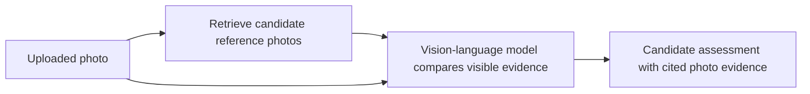

# RAG and the machine learning techniques in this project

## What RAG means

**Retrieval-augmented generation (RAG)** combines a search system with a generative
model. It retrieves relevant external information, then gives that information to
a model to help it produce an answer. For example, a support chatbot retrieves
product documentation before writing a response. Retrieval provides information
that can change without retraining the language model; generation writes the
response. See the [original RAG paper](https://arxiv.org/abs/2005.11401).

Our project currently performs **retrieval, without answer generation**. It
searches geotagged photos and returns location candidates. Qdrant and embeddings
are technologies often used in RAG, but their presence alone does not make a
system RAG. Averaging candidate coordinates is also not generative AI.

A possible future multimodal RAG flow would be:

That could help explain or verify a match. It would still need measured accuracy:
a fluent explanation can be wrong, and it is not necessarily an account of how
the retrieval model selected its candidates. The supporting photos and visible
clues should be inspectable.

## Techniques we use, and ones we do not yet use

| Technique | Plain-language meaning | Project status |
| --- | --- | --- |
| Pretrained models / transfer learning | Reuse features learned on large external datasets | Yes: CLIP in the API, MegaLoc frozen in experiments; a geographic head is now locally trained |
| Embeddings / representation learning | Encode an image as numbers suitable for comparison | Yes: CLIP 768-D, MegaLoc 8,448-D |
| Vision transformers | Image models that process patches using attention | Yes: the CLIP and MegaLoc encoders use transformer architectures |
| Contrastive learning | Learn to bring related examples closer and separate unrelated ones | Part of the relevant pretrained-model research; we are not running a contrastive training job |
| Vector search | Find stored descriptors close to a query descriptor | Yes: Qdrant in the API; exact FAISS search in evaluation |
| Visual place recognition | Match a query photo to geotagged views of the same place | Yes: this is the main current approach |
| GPU inference | Run a trained model to compute descriptors | Yes: native Apple MPS for MegaLoc; CPU by default in the container API; CUDA paths exist |
| Cached inference | Reuse descriptors for unchanged inputs rather than encode again | Yes: resumable caches record model/software identity and input hashes |
| Held-out evaluation | Test on examples kept out of the reference/training set | Yes: frozen query sets, capture-sequence exclusion and duplicate checks; currently same-provider development tests |
| Geographic prediction | Infer geographic regions from clues beyond matching a known scene | A first1km geographic head is trained; it did not beat a constant-area prior. PIGEON/PIGEOTTO remain research directions |
| Fine-tuning | Change pretrained weights using our own training examples | A frozen-backbone geographic head has been trained; backbone fine-tuning has not been performed |
| LoRA / parameter-efficient fine-tuning | Train a small set of extra parameters instead of all model weights | Not implemented or currently needed for gallery indexing |
| Reranking / geometric verification | Re-examine retrieved candidates using stronger comparisons | Not implemented as a second model stage |
| Geographic clustering | Group nearby location candidates before choosing an estimate | Not implemented in the current API; planned alternative to averaging scattered matches |
| Vision-language model / OCR clues | Describe visible evidence or read text and use it for verification | No integrated vision-language or OCR inference stage |
| RAG / generated explanations | Generate an answer using retrieved evidence | Not implemented |
| Confidence calibration | Make reported scores correspond to observed correctness rates | Not implemented; current similarity scores are not calibrated probabilities |

The model descriptions and retrieval goals are documented in the
[MegaLoc paper](https://arxiv.org/abs/2502.17237) and
[CLIP paper](https://arxiv.org/abs/2103.00020). The broader geographic-prediction
direction is described in [PIGEON/PIGEOTTO](https://arxiv.org/abs/2307.05845).

## Indexing is different from training

When we add 3,000 Linköping reference photos, we run the existing encoder on them
and store the resulting descriptors. Model weights remain unchanged. The system
can then retrieve those new references. This is **indexing / inference**, not
training, fine-tuning or RAG generation.

Training would instead construct learning examples, compute a loss and update
model parameters. It requires a separate train/validation/test protocol and GPU
budget. More reference coverage can improve retrieval before any such training.

## What happened to the older training code?

Training code does exist: `swespy/swespy/model/trainer.py` and
`swespy/scripts/train.py`. The original approach attaches an S2 geographic-cell
classifier to CLIP. The vision backbone is frozen; the projection and classifier
can be trained. It is related to geographic classification, but it is not a
reproduction of the full PIGEON/PIGEOTTO training method.

Before the first controlled training experiment, two concrete issues prevented simply rerunning it:

1. Its old split put entire S2 classes in disjoint training and validation sets, but
   the class-index map is built only from training labels. Validation examples
   therefore contained labels absent from that map. This is not a valid closed-set
   classifier evaluation and can raise a label lookup error.
2. The default indexer and API instantiate the original pretrained CLIP encoder;
   they do not load the saved classifier checkpoint. Running that training script
   would not improve the current API's predictions.

The [existing audit](AUDIT.md) records these issues. The code supports the user's
memory of earlier training work; it does not establish which historical runs
finished or recover deleted checkpoints. The split and explicit checkpoint loading have now been repaired. A separate
head was trained on cached MegaLoc features and connected to CLI inference; see
[the first training experiment](FIRST_TRAINING_EXPERIMENT.md). It did not beat a
constant geographic prior and has not replaced the default API.

## When should we train our own model?

The first deliberate training experiment has now followed the expanded-gallery
baseline and frozen ordinary-photo set. It improved some thresholds over retrieval
but did not beat a constant-area guess. Further training needs better visual
coverage, appropriate cross-view pairs and a fresh independent holdout.

Two useful experiments serve different purposes:

- **Geographic classifier:** train a region/cell prediction head on Swedish data,
  with capture-sequence-separated validation and training examples for every
  closed-set output class. This can propose a geographic area, but does not by
  itself identify an exact building. A cheap head-training baseline should come
  before expensive backbone updates.
- **Retrieval fine-tuning:** train a place-recognition encoder on independently
  captured views of shared places, contrasting them with different locations.
  This targets matching ordinary photos to references across viewpoint/appearance
  changes. Fine-tuning may help, but needs suitable positives, hard negatives and
  evaluation beyond adjacent frames from one drive.

Both experiments must preserve untouched test photos and compare with the frozen
pretrained baseline. If encoder weights change, references must be re-encoded so
query and gallery descriptors stay compatible. Cloud GPUs accelerate training;
they do not fix missing reference coverage, label errors or an invalid split.

## How this relates to our next milestone

We have encoded the expanded gallery with the already verified MegaLoc model,
evaluated48 frozen queries, and exported an exact searchable index with a row-to-
photo/GPS mapping. See [the measured results](CITY_EVALUATION.md). We report
coverage separately from Recall@K, and keep uncovered
queries in the denominator. This is a modern neural retrieval system even though
it does not have an LLM, agent or RAG generation stage.

An independent ordinary-photo test set should guide the next model improvement.
Adding a geographic predictor, a verification model or explanations is useful
only if it improves a measured user-facing capability. See
[the agent handoff](AGENT_HANDOFF.md) for the current task and artifact locations.
